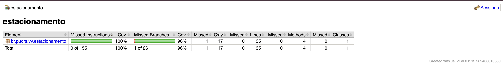
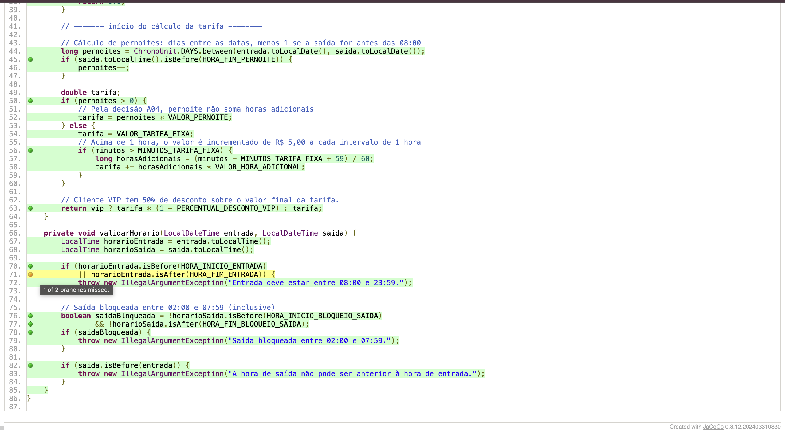
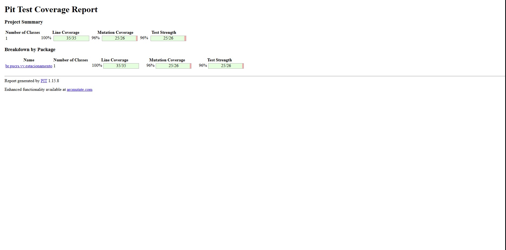
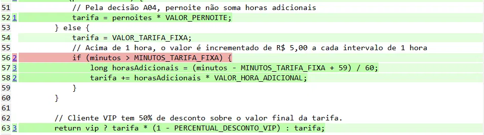
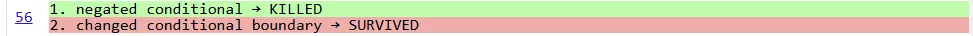

# Casos de Teste Oficiais - T1 V&V

Esta tabela cobre todas as partições de equivalência (seção 5) e fronteiras (seção 6), seguindo estritamente as decisões de negócio (seção 3) e o padrão do documento.

| ID | Técnica (Partição ou Limite + qual CV/CI/fronteira cobre) | Entrada | Saída | VIP | Esperado |
| :--- | :--- | :--- | :--- | :--- | :--- |
| T01 | Limite Cortesia (Antes, 19 min) (CV01) | 05/10/2026 10:00 | 05/10/2026 10:19 | Não | R$ 0,00 |
| T02 | Limite Cortesia (No limite, 20 min) (CV01) | 05/10/2026 10:00 | 05/10/2026 10:20 | Não | R$ 0,00 |
| T03 | Limite Cortesia (Depois, 21 min) (CV02) | 05/10/2026 10:00 | 05/10/2026 10:21 | Não | R$ 15,00 |
| T04 | Limite Tarifa Fixa (Antes, 59 min) (CV02) | 05/10/2026 10:00 | 05/10/2026 10:59 | Não | R$ 15,00 |
| T05 | Limite Tarifa Fixa (No limite, 60 min) (CV02) | 05/10/2026 10:00 | 05/10/2026 11:00 | Não | R$ 15,00 |
| T06 | Limite Tarifa Fixa (Depois, 61 min) (CV03) | 05/10/2026 10:00 | 05/10/2026 11:01 | Não | R$ 20,00 |
| T07 | Limite Hora Adicional (Antes, 119 min) (CV03) | 05/10/2026 10:00 | 05/10/2026 11:59 | Não | R$ 20,00 |
| T08 | Limite Hora Adicional (No limite, 120 min) (CV03) | 05/10/2026 10:00 | 05/10/2026 12:00 | Não | R$ 20,00 |
| T09 | Limite Hora Adicional (Depois, 121 min) (CV03) | 05/10/2026 10:00 | 05/10/2026 12:01 | Não | R$ 25,00 |
| T10 | Limite Início Entrada (Antes, 07:59) (CI01) | 05/10/2026 07:59 | 05/10/2026 10:00 | Não | Exceção |
| T11 | Limite Início Entrada (No limite, 08:00) (CV06) | 05/10/2026 08:00 | 05/10/2026 10:00 | Não | R$ 20,00 |
| T12 | Limite Início Entrada (Depois, 08:01) (CV06) | 05/10/2026 08:01 | 05/10/2026 10:00 | Não | R$ 20,00 |
| T13 | Limite Fim Entrada (Antes, 23:58) (CV06) | 05/10/2026 23:58 | 06/10/2026 00:18 | Não | R$ 0,00 |
| T14 | Limite Fim Entrada (No limite, 23:59) (CV06) | 05/10/2026 23:59 | 06/10/2026 00:19 | Não | R$ 0,00 |
| T15 | Limite Fim Entrada (Depois, 00:00) (CI01) | 06/10/2026 00:00 | 06/10/2026 08:00 | Não | Exceção |
| T16 | Limite Início Bloqueio Saída (Antes, 01:59) (CV08) | 05/10/2026 23:00 | 06/10/2026 01:59 | Não | R$ 25,00 |
| T17 | Limite Início Bloqueio Saída (No limite, 02:00) (CI02) | 05/10/2026 23:00 | 06/10/2026 02:00 | Não | Exceção |
| T18 | Limite Início Bloqueio Saída (Depois, 02:01) (CI02) | 05/10/2026 23:00 | 06/10/2026 02:01 | Não | Exceção |
| T19 | Limite Fim Bloqueio Saída (Antes, 07:58) (CI02) | 05/10/2026 23:00 | 06/10/2026 07:58 | Não | Exceção |
| T20 | Limite Fim Bloqueio Saída (No limite, 07:59) (CI02) | 05/10/2026 23:00 | 06/10/2026 07:59 | Não | Exceção |
| T21 | Limite Fim Bloqueio Saída (Depois, 08:00) (CV04) | 05/10/2026 23:00 | 06/10/2026 08:00 | Não | R$ 50,00 |
| T22 | Limite 1->2 Pernoites (Antes, 01:59 no 2º dia seguinte) (CV04) | 05/10/2026 10:00 | 07/10/2026 01:59 | Não | R$ 50,00 |
| T23 | Limite 1->2 Pernoites (No limite, 08:00 no 2º dia seguinte) (CV05) | 05/10/2026 10:00 | 07/10/2026 08:00 | Não | R$ 100,00 |
| T24 | Limite 1->2 Pernoites (Depois, 08:01 no 2º dia seguinte) (CV05) | 05/10/2026 10:00 | 07/10/2026 08:01 | Não | R$ 100,00 |
| T25 | Limite Ordem Temporal (Antes, -1 min) (CI03) | 05/10/2026 10:00 | 05/10/2026 09:59 | Não | Exceção |
| T26 | Limite Ordem Temporal (No limite, 0 min) (CV01) | 05/10/2026 10:00 | 05/10/2026 10:00 | Não | R$ 0,00 |
| T27 | Limite Ordem Temporal (Depois, +1 min) (CV01) | 05/10/2026 10:00 | 05/10/2026 10:01 | Não | R$ 0,00 |
| T28 | Partição VIP com Cortesia (CV10, CV01) | 05/10/2026 10:00 | 05/10/2026 10:15 | Sim | R$ 0,00 |
| T29 | Partição VIP com Hora Adicional (CV10, CV03) | 05/10/2026 10:00 | 05/10/2026 12:30 | Sim | R$ 12,50 |
| T30 | Partição VIP com Pernoite (CV10, CV04) | 05/10/2026 20:00 | 06/10/2026 10:00 | Sim | R$ 25,00 |
| T31 | Partição Nulidade - Entrada nula (CI04) | nulo | 05/10/2026 10:00 | Não | Exceção |
| T32 | Partição Nulidade - Saída nula (CI05) | 05/10/2026 10:00 | nulo | Não | Exceção |
| T33 | Partição Tarifa sem teto - 1079 min (CV08) | 05/10/2026 08:00 | 06/10/2026 01:59 | Não | R$ 100,00 |
| T34 | Cobertura de Desvio - Entrada após 23:59 com segundos (Linha 71, ramo `true` de `isAfter`) (CI01) | 05/10/2026 23:59:30 | 06/10/2026 08:00:00 | Não | Exceção |

---

# Trabalho 2 - Parte A: Análise Crítica de Cobertura de Código (JaCoCo)

## 1. Resultados Iniciais ("Antes" — Testes T01 a T33 do Trabalho 1)

Com a execução dos 33 casos de teste originais do Trabalho 1 (`T01` a `T33`), o relatório de cobertura gerado pelo **JaCoCo** apresentou as seguintes métricas para a classe `CalculadoraTarifa`:

| Métrica (JaCoCo) | Coberto / Total | Percentual |
| :--- | :---: | :---: |
| **Instruções (*Instructions*)** | 155 / 155 | **100%** |
| **Desvios / Ramos (*Branches*)** | 25 / 26 | **96%** |
| **Linhas (*Lines*)** | 35 / 35 | **100%** |
| **Métodos (*Methods*)** | 4 / 4 | **100%** |
| **Classes (*Classes*)** | 1 / 1 | **100%** |



---

## 2. Análise Crítica da Cobertura de Código

Analisando o relatório detalhado do código-fonte no JaCoCo, verifica-se que **100% das instruções e linhas** foram executadas (nenhum trecho em vermelho). No entanto, a cobertura de desvios (*Branches*) atingiu **96% (25 de 26 ramos)**, restando **1 desvio parcialmente coberto** (marcado com losango amarelo na **linha 71** com a indicação *"1 of 2 branches missed"*):



### Ponto onde é necessário novo caso de teste:
* **Localização:** Método `validarHorario(LocalDateTime entrada, LocalDateTime saida)`, **linhas 70–71**:
  ```java
  if (horarioEntrada.isBefore(HORA_INICIO_ENTRADA)
      || horarioEntrada.isAfter(HORA_FIM_ENTRADA)) {
      throw new IllegalArgumentException("Entrada deve estar entre 08:00 e 23:59.");
  }
  ```
* **Motivo da não cobertura:**
  * A constante `HORA_FIM_ENTRADA` é definida como `LocalTime.of(23, 59)` (equivalente a `23:59:00`).
  * Todos os casos de teste do Trabalho 1 (`T01` a `T33`) utilizavam horários apenas com horas e minutos (`HH:mm`, com segundos zerados).
  * No caso `T14` (`23:59`), `horarioEntrada.isAfter(23:59:00)` resulta em **`false`**.
  * No caso `T15` (`00:00`), o horário de entrada é `00:00:00`, fazendo com que a primeira condição (`horarioEntrada.isBefore(08:00)`) já seja **`true`** (ocorrendo avaliação por curto-circuito do operador `||`) e, além disso, `00:00` não é posterior a `23:59`.
  * Consequentemente, a condição `horarioEntrada.isAfter(HORA_FIM_ENTRADA)` na **linha 71** nunca assumiu o valor **`true`**.
* **Como cobrir o desvio faltante:**
  * É necessário um caso de teste onde `horarioEntrada.isBefore(08:00)` seja **`false`** e `horarioEntrada.isAfter(23:59:00)` seja **`true`**.
  * Isso ocorre exclusivamente quando o horário de entrada possui segundos acima de zero no minuto `23:59` (entre `23:59:01` e `23:59:59`), como **`05/10/2026 23:59:30`**, provocando o lançamento de `IllegalArgumentException` pelo ramo verdadeiro da linha 71.

---

## 3. Conjunto de Novos Casos de Teste (Tabular)

| ID | Técnica / Objetivo (Desvio coberto) | Entrada | Saída | VIP | Esperado |
| :--- | :--- | :--- | :--- | :--- | :--- |
| **T34** | Cobertura de Desvio — Linha 71 (`horarioEntrada.isAfter(23:59)` avaliando para `true` com segundos) (CI01) | 05/10/2026 23:59:30 | 06/10/2026 08:00:00 | Não | Exceção |

## Casos novos do T2 (cobertura)


---

# Trabalho 2 - Parte B: Análise Crítica de Mutação (PIT)

Os testes do T1 e do T2 matam os **25 mutantes que podem ser mortos**. O único sobrevivente (**linha 56**) é **equivalente**, então nenhum caso novo foi necessário.

## 1. Ferramenta e Configuração

Foi usado o **PIT 1.15.8** (`pitest-maven`) com o `pitest-junit5-plugin` 1.2.1 e o `junit-platform-launcher` 1.10.2, necessário para o PIT rodar testes do JUnit 5. O relatório é gerado com `mvn test-compile org.pitest:pitest-maven:mutationCoverage` em `target/pit-reports/index.html`.

* **Classe mutada:** apenas `CalculadoraTarifa` (`targetClasses`). A classe `App` fica de fora por ser só uma demonstração com `main`, sem regra de negócio.
* **Testes usados:** todo arquivo `br.pucrs.vv.estacionamento.*Test` (`targetTests`), ou seja, `CalculadoraTarifaTest` (T01–T33) e `CalculadoraTarifaCoberturaTest` (T34).
* **Mutadores:** o grupo padrão do PIT (*DEFAULTS*), sem alteração: `CONDITIONALS_BOUNDARY`, `EMPTY_RETURNS`, `FALSE_RETURNS`, `INCREMENTS`, `INVERT_NEGS`, `MATH`, `NEGATE_CONDITIONALS`, `NULL_RETURNS`, `PRIMITIVE_RETURNS`, `TRUE_RETURNS` e `VOID_METHOD_CALLS`.

Na `CalculadoraTarifa`, esses mutadores geram **26 mutantes**:

| Mutador | O que faz | Mutantes | Linhas |
| :--- | :--- | :---: | :--- |
| `NEGATE_CONDITIONALS` | Inverte a condição de um `if` | 13 | 28 (2), 37, 45, 50, 56, 63, 70, 71, 76, 77, 78, 82 |
| `MATH` | Troca o operador aritmético (ex.: `*` por `/`) | 8 | 46, 52, 57 (3), 58 (2), 63 |
| `CONDITIONALS_BOUNDARY` | Troca `<` por `<=`, `>` por `>=` e vice-versa | 3 | 37, 50, 56 |
| `VOID_METHOD_CALLS` | Remove a chamada de um método `void` | 1 | 33 (`validarHorario`) |
| `PRIMITIVE_RETURNS` | Troca o valor retornado por `0.0` | 1 | 63 |

---

## 2. Resultados (Mutation Coverage nos três momentos)

O *Mutation Coverage* ficou em **96% (25 de 26)** nos três momentos, porque o único mutante vivo é equivalente e nenhum teste consegue matá-lo.

| Momento | Casos | Line Coverage | Mutation Coverage | Test Strength |
| :--- | :--- | :---: | :---: | :---: |
| 1. Só os casos do T1 | 33 (T01–T33) | 100% (36/36) | **96% (25/26)** | 96% (25/26) |
| 2. T1 + casos de cobertura | 34 (T01–T34) | 100% (35/35) | **96% (25/26)** | 96% (25/26) |
| 3. Final (T1 + cobertura + mutação) | 34 (nenhum caso de mutação) | 100% (35/35) | **96% (25/26)** | 96% (25/26) |

A *Line Coverage* foi de 36/36 para 35/35 sem nenhuma linha deixar de ser executada: o que mudou foi o total de linhas que o PIT conta. O momento 1 foi gerado em outro computador, e cada compilação pode registrar as linhas do código de forma um pouco diferente (por exemplo, uma condição quebrada em duas linhas). Compilada no Codespace, a classe tem 35 linhas executáveis. Nos dois casos são os mesmos 26 mutantes, com o mesmo resultado.

O caso **T34** (entrada às `23:59:30`) fechou o desvio da linha 71 no JaCoCo, mas não mudou o placar do PIT: o mutante dessa linha já era morto pelos casos do T1 (ver seção 3).



*Página inicial do PIT depois dos testes de cobertura (T01–T34): Line Coverage 35/35, Mutation Coverage 25/26 e Test Strength 25/26.*

---

## 3. Análise Crítica dos Mutantes Sobreviventes

Só um mutante sobreviveu, e ele é **equivalente**: muda o código, mas não muda o resultado para nenhuma entrada. Não houve mutantes `NO_COVERAGE` nem `TIMED_OUT`.

| Linha | Mutação (como o PIT descreve) | Status | Classificação | Justificativa |
| :---: | :--- | :---: | :---: | :--- |
| 56 | *changed conditional boundary*: `minutos > MINUTOS_TARIFA_FIXA` virou `minutos >= MINUTOS_TARIFA_FIXA` | SURVIVED | **Equivalente** | Com 60 min, `horasAdicionais = 59 / 60 = 0` (divisão inteira); a tarifa continua R$ 15,00, igual ao original |



*Código da `CalculadoraTarifa` no PIT: a linha 56 aparece em vermelho porque tem um mutante sobrevivente.*



*Lista Mutations da linha 56: a negação da condição foi morta (KILLED), e a troca de `>` por `>=` sobreviveu (SURVIVED).*

### Por que o mutante da linha 56 é equivalente:

1. `minutos > 60` e `minutos >= 60` só dão resultados diferentes quando `minutos` vale **exatamente 60**. Para qualquer outro valor, original e mutante seguem o mesmo caminho.
2. Com `minutos = 60`, o mutante entra no `if` e calcula `horasAdicionais = (60 - 60 + 59) / 60 = 59 / 60 = 0`, porque a divisão entre `long` descarta a parte decimal.
3. A linha seguinte faz `tarifa += 0 * 5.00`, ou seja, soma R$ 0,00. A tarifa continua **R$ 15,00** (ou R$ 7,50 para VIP), o mesmo valor que o original devolve sem entrar no `if`.
4. Os segundos não criam uma saída: `Duration.toMinutes()` trunca, então qualquer permanência de 60:00 a 60:59 vira `minutos = 60` e cai no mesmo cálculo.

O caso **T05** do T1 (10:00 → 11:00, 60 min, R$ 15,00) já testa exatamente essa fronteira. Ele passa no original e no mutante porque os dois devolvem o mesmo valor, e não existe entrada que os diferencie.

Para confirmar a conta, comparamos o código original com uma cópia contendo a mutação da linha 56. Foram **14.790.140 combinações** de entrada, saída e VIP: todo minuto de entrada de um dia, saídas de −2 h a +3 dias, mais 2 milhões de casos com segundos aleatórios. **Nenhuma combinação deu resultado ou exceção diferente.**

### O que o mutante mostra sobre o código:

O `if` da linha 56 é **redundante**. Quando o código chega nele, a linha 37 já garantiu `minutos >= 21`, e para qualquer valor de 21 a 60 a fórmula já dá zero:

```
horasAdicionais = (minutos - 60 + 59) / 60 = (minutos - 1) / 60 = 0   para 21 <= minutos <= 60
```

O `if` só evita somar zero, por isso mudar a fronteira dele não tem efeito. Não alteramos a classe, pela regra do grupo de que o T2 é sobre testes. Fica registrado que a mesma redundância faria até a remoção completa do `if` passar despercebida.

### Cobertura e mutação medem coisas diferentes:

Na **linha 71**, o JaCoCo apontava um desvio não testado (`isAfter(23:59)` nunca verdadeiro antes do T34), mas o PIT já matava o mutante dessa linha só com os casos do T1. Ao inverter a condição, toda entrada válida passa a lançar exceção, e qualquer caso válido (T11, por exemplo) percebe. O inverso também vale: 100% de linhas cobertas não mostrava que a linha 56 tinha uma fronteira que nenhum teste consegue distinguir. Foi o PIT que levou a essa análise.

---

## 4. Conjunto de Novos Casos de Teste (Tabular)

**Nenhum caso novo foi necessário.** O único sobrevivente é equivalente, então nenhum teste consegue matá-lo, e a fronteira de 60 min já é testada pelo T05. Criar um caso só para "tentar" matá-lo repetiria o T05 sem acrescentar nada.

| ID | Objetivo (mutante que mata) | Entrada | Saída | VIP | Esperado |
| :--- | :--- | :--- | :--- | :--- | :--- |
| — | Nenhum caso novo necessário (mutante da linha 56 é equivalente) | — | — | — | — |

Por isso, o arquivo `CalculadoraTarifaMutacaoTest.java` não foi criado, e a numeração dos casos termina no **T34**.

---

## 5. Conclusão

Os 34 casos matam **100% dos mutantes não equivalentes (25 de 25)**. O score de 96% é, portanto, o máximo possível para esta classe, e ficar abaixo de 100% é aceitável porque o sobrevivente tem justificativa com a conta que prova a equivalência.

A mutação mostrou o que a cobertura não mostrava: 100% de linhas executadas não garante que os testes conferem o resultado, e foi o PIT que revelou a redundância do `if` da linha 56. Ao mesmo tempo, o desvio que o JaCoCo apontou na linha 71 não enfraquecia os testes do ponto de vista da mutação, o que confirma que as duas métricas se complementam.


| ID | Técnica / Objetivo (Desvio coberto) | Entrada | Saída | VIP | Esperado |
| :--- | :--- | :--- | :--- | :--- | :--- |
| **T34** | Cobertura de Desvio — Linha 71 (`horarioEntrada.isAfter(23:59)` avaliando para `true` com segundos) (CI01) | 05/10/2026 23:59:30 | 06/10/2026 08:00:00 | Não | Exceção |

